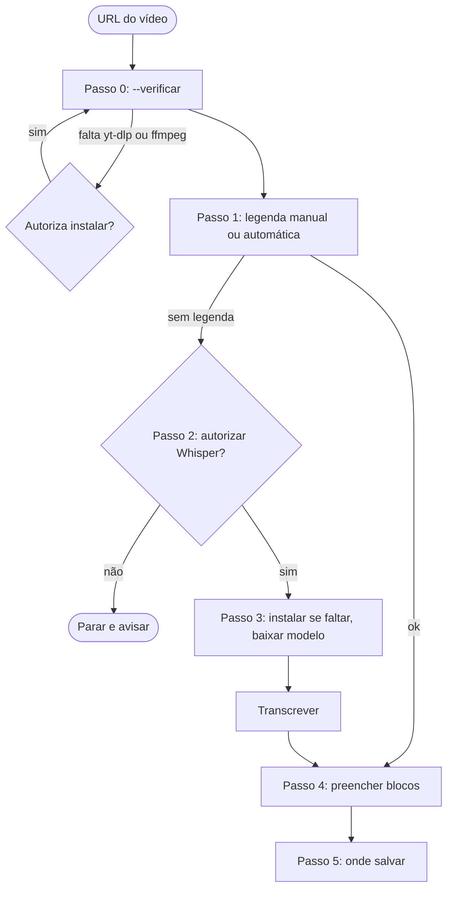

# Transcriptor YouTube → nota em markdown

A transcrição não é traduzida: sai no idioma falado no vídeo. O script faz o
trabalho mecânico e escreve a nota com o esqueleto pronto. O agente preenche
os blocos marcados como pendentes.



## Passo 0: verificar o ambiente

Antes de qualquer coisa:

```bash
python3 <skill>/scripts/transcribe_video.py --verificar
```

A saída é JSON. `yt-dlp` e `ffmpeg` são obrigatórios para qualquer vídeo. Se um
dos dois faltar, não siga em frente sem eles. Pergunte ao usuário se quer
instalar e diga o comando que vai rodar:

> Para transcrever, preciso de `yt-dlp` e `ffmpeg` no PATH, e eles não estão
> instalados. Posso instalar agora com `<comando>`? Autoriza?

Só rode depois do "sim", e use o instalador:

```bash
python3 <skill>/install.py --instalar-deps --sim
```

A autorização para instalar `yt-dlp` ou `ffmpeg` vale apenas para essa instalação
e não autoriza instalar Whisper ou outros pacotes. Se o sistema não tiver
gerenciador automático (Linux) ou ele não estiver instalado (Homebrew no Mac,
winget no Windows), diga ao usuário o que falta e pare. Depois da instalação,
rode `--verificar` de novo.

O Whisper não é obrigatório. Ele só entra no passo 2, quando a legenda não existe.

## Passo 1: obter a legenda

```bash
python3 <skill>/scripts/transcribe_video.py "<url>" --out-dir <dir-temporario>
```

Use um diretório temporário novo e dedicado a esta execução. Não crie pastas no
projeto do usuário nesta etapa. A língua falada vem de `language` nos metadados;
não passe `--primary` a menos que o script peça.

Ordem fixa: **legenda manual, depois automática**. Se o script sair com código
**3** e a mensagem `PRECISA_WHISPER`, não há legenda na língua falada. Só então
vá para o passo 2. Não use `--fonte whisper` sem passar pelo passo 2.

Se o script sair com código 2 (outro erro), pare e reporte o trecho do erro. Não
tente flags alternativas nem repetições em loop. Em qualquer falha, não apresente
a nota como concluída e diga o que já foi baixado ou instalado nesta execução.

## Passo 2: pedir autorização para o Whisper

Quando o script disser `PRECISA_WHISPER`, use a mensagem que casa com o que o
`--verificar` mostrou. Não instale nada antes da resposta.

A autorização vale apenas para este vídeo e esta execução, e somente para as
ações informadas no pedido. Uma autorização anterior para Whisper não vale para
outro vídeo ou execução, a menos que o usuário tenha pedido explicitamente uma
autorização recorrente. Autorizar a instalação do Whisper não autoriza instalar
dependências básicas ou outros pacotes não mencionados. As dependências
transitivas necessárias ao pacote escolhido devem ser descritas como parte da
instalação (por exemplo, PyTorch para `openai-whisper`).

Explique que o fluxo com Whisper baixa o áudio do vídeo para transcrição local e
pode baixar o modelo indicado se ele ainda não estiver no cache. Peça autorização
para esse conjunto de ações; não trate silêncio como consentimento.

Se o usuário não responder, mantenha a solicitação pendente. Se houver outro
turno antes da resposta, comece avisando que a transcrição continua aguardando
autorização. Não instale, baixe o áudio nem inicie a transcrição enquanto aguarda.
Não repita a solicitação, a menos que seja pertinente ao turno.

Se o usuário recusar, não prossiga com Whisper. Apague somente os arquivos
transitórios criados por esta execução, dentro do diretório temporário dedicado,
e informe que a nota não foi gerada. Nunca apague diretório escolhido pelo
usuário, arquivo preexistente ou conteúdo de uma pasta compartilhada.

Se o Whisper já estiver instalado, a autorização ainda é necessária para baixar
o áudio e executar a transcrição; ela não é necessária para instalar algo que já
existe.

**A) Já existe Whisper instalado** (`mlx_whisper` ou `openai-whisper` = `true`).
Avise que o fallback do Whisper vai ser usado e peça autorização. Não há escolha:

> Esse vídeo não tem legenda manual nem automática em `<idioma>`. Vou baixar o
> áudio e usar o Whisper como fallback, com `<ferramenta instalada>`. A transcrição
> é local e pode baixar um modelo de cerca de 1,6 GB, se ainda não estiver no
> cache. Autoriza baixar o áudio, executar a transcrição e, se necessário, baixar
> o modelo?

**B) Mac com Apple Silicon, sem Whisper instalado.** Ofereça as duas opções, com
recomendação para o `mlx_whisper`:

> Esse vídeo não tem legenda. Para transcrever, preciso de um Whisper, que ainda
> não está instalado. Posso baixar o áudio e instalar e usar uma das opções:
>
> - **mlx_whisper** (recomendado neste Mac): usa a GPU do Apple Silicon e é mais rápido.
> - **openai-whisper**: instala PyTorch, que é grande (vários GB), e a transcrição tende a ser mais lenta.
>
> O modelo (cerca de 1,6 GB) também será baixado se necessário. Qual ferramenta
> você autoriza instalar e usar, incluindo o download do áudio e do modelo?

**C) Windows, Linux ou Mac sem Apple Silicon, sem Whisper instalado.** O
`mlx_whisper` não roda aqui, então só existe a opção do `openai-whisper`:

> Esse vídeo não tem legenda. Para transcrever, preciso de um Whisper, que ainda
> não está instalado. Vou baixar o áudio e instalar o openai-whisper, que instala
> o PyTorch (vários GB) e tende a ser mais lento que no Mac com Apple Silicon. O
> modelo (cerca de 1,6 GB) será baixado se necessário. Autoriza instalar o pacote
> e baixar o áudio e o modelo?

Se houver instalação autorizada, instale somente a ferramenta escolhida. Use
`pip install mlx-whisper` ou `pip install openai-whisper`; para isolar o ambiente,
`uv tool install mlx-whisper` também é uma opção para Apple Silicon. Dependências
transitivas do pacote escolhido fazem parte dessa instalação já descrita; não rode
comandos separados para instalar pacotes adicionais que não foram mencionados e
autorizados. Depois siga para a fase A ou B abaixo.

Em caso de recusa em qualquer opção, aplique a regra de limpeza acima: pare, apague
somente os arquivos transitórios desta execução e explique que a nota não foi
gerada.

Se o usuário autorizar a instalação, mas ela falhar, pare e reporte a falha; não
inicie o download de áudio nem a transcrição. Se a execução falhar depois de
baixar áudio, instalar pacote ou baixar modelo, informe quais dessas ações foram
concluídas. Nunca trate uma nota parcial como concluída.

## Passo 3: preparar o modelo e transcrever

Com o Whisper autorizado, prefira o mecanismo de execução em background oferecido
pelo agente, que deve devolver um identificador ou aviso de conclusão. Não use
`&` nem `nohup` para destacar o processo do agente. Antes de iniciar, avise que a
transcrição pode demorar e que você informará quando terminar.

Se o agente não oferecer execução em background, execute o comando em primeiro
plano somente se a ferramenta puder aguardar a conclusão. Avise que a chamada pode
manter a interação ocupada; não diga que o processo continua em execução antes de
receber essa confirmação. Aguarde o resultado e só então informe a conclusão. Se a
ferramenta interromper a chamada ou o estado do processo ficar incerto, não inicie
outra execução: use o identificador de processo/tarefa já devolvido, se existir,
para determinar o estado; se não houver como verificar com segurança, informe que
a execução foi interrompida ou ficou sem confirmação e peça orientação antes de
tentar novamente.

**Fase A, só com `mlx_whisper`: baixar e verificar o modelo**

```bash
python3 <skill>/scripts/transcribe_video.py --preparar --out-dir <dir-de-trabalho>
```

- Ao começar, diga ao usuário: "Baixando o modelo (cerca de 1,6 GB). Acompanho
  em `<dir>/progresso.txt`."
- Quando o processo terminar com a mensagem `modelo pronto e verificado`, diga:
  "Download concluído e verificado. Iniciando a transcrição."
- Se a saída trouxer erro de hash, pare e avise. Não use o arquivo.

Com `openai-whisper`, não há fase A: primeiro o script baixa o áudio do vídeo;
depois o pacote baixa o modelo durante a transcrição, se ele ainda não estiver
no cache. Avise o usuário que ambos os downloads podem aumentar o tempo da
primeira execução.

**Fase B: transcrever**

```bash
python3 <skill>/scripts/transcribe_video.py "<url>" --fonte whisper --out-dir <dir-de-trabalho>
```

Ao iniciar, diga "Transcrição começando". O progresso vai para
`<dir>/progresso.txt`, em marcos de 5%, e o log completo para `whisper.log`.

Quando o processo terminar, leia a saída. Ela traz o caminho da nota. Se o código
de saída não for 0, reporte o erro e pare; informe quais downloads ou instalações
já ocorreram nesta execução.

**Acompanhar sem ficar consultando.** O aviso de conclusão do processo basta. Leia
`progresso.txt` só se o usuário pedir. Não fique repetindo a leitura em loop. Se
houver outro turno enquanto o processo ainda roda, informe esse estado sem iniciar
outra execução nem repetir consultas em loop.

## Passo 4: preencher os blocos pendentes

Leia a transcrição inteira antes de escrever. Preencha só os blocos que têm o
marcador `<!-- PENDENTE: agente preenche -->`.

**Classificação.** Escolha um valor de propósito e um de formato, cada um da
lista que aparece no bloco. Grave-os, respectivamente, nos campos do frontmatter
`proposito` e `formato`, e substitua os marcadores correspondentes no bloco.
Use as categorias do YouTube só como pista: o conteúdo manda. Se uma opção não
se encaixar bem, escolha a mais próxima e justifique em uma linha.

**Propósito** descreve para que o vídeo foi feito (por exemplo, ensinar, informar,
entreter ou apoiar uma decisão). **Formato** descreve como o conteúdo é
apresentado (por exemplo, aula, entrevista, tutorial ou documentário). Escolha
cada um separadamente, com base no conteúdo, não apenas nas categorias do YouTube.

**Resumo.** Um parágrafo ou no máximo cinco frases, dizendo o que o vídeo
apresenta, qual é a tese ou o objetivo do autor e como ele conclui. Baseie-se só
no que está na transcrição e na descrição. Não acrescente contexto de fora.

**Pontos importantes.** Lista de 3 a 8 itens com timestamp. Cada item é uma
afirmação, decisão, número ou passo que o autor destaca. Use o tempo do início do
trecho relevante, no formato `MM:SS` ou `HH:MM:SS` para vídeos com uma hora ou
mais. Não estime: use os tempos do arquivo `<idioma>.dedup.txt` gerado junto da
nota, dos capítulos oficiais ou de ambos. Se não houver timestamp confiável,
escreva `sem timestamp confiável` no item.

**Pontos de atenção.** Inclua de 0 a 6 itens com timestamp, apenas quando houver
motivo concreto para o leitor conferir ou ter cuidado. Quando houver material
suficiente, priorize 2 a 6 itens, mas não invente nem duplique ressalvas para
atingir um mínimo. Use o mesmo formato e critério de timestamp dos pontos
importantes. Motivos concretos incluem:

- afirmação do autor com ressalva ("depende", "em teoria", "não testei");
- número, versão, preço ou prazo apresentado sem contexto ou que o autor diga que
  precisa ser conferido em fonte primária;
- promessa forte ou resultado sem contexto relevante;
- termo, nome próprio ou número que a transcrição possa ter reconhecido errado.
  Identifique o trecho e o termo transcrito; não adivinhe a correção.

Se a fonte for Whisper, indique brevemente essa limitação de reconhecimento na
seção, sem sugerir que um trecho específico está errado se não houver evidência.
Se não houver nenhum ponto concreto, escreva `_Nenhum ponto de atenção específico
identificado._` em vez de forçar itens.

Não traduza a transcrição, não crie glossário, diagrama ou seção de aplicação.
Esses blocos não fazem parte desta skill.

## Passo 5: onde salvar

Use a primeira regra que se aplicar:

1. **Instruções do projeto definem destino.** Procure `AGENTS.md` ou `CLAUDE.md`
   no diretório de trabalho e nos pais. Se houver regra aplicável ao destino
   desta nota, siga-a.
2. **Há instruções do projeto, mas nenhuma regra aplicável de destino.** Salve em
   `transcriptions/transcription-<slug>.md`, relativo ao diretório de trabalho.
   Crie a pasta se não existir.
3. **Não existe `AGENTS.md` nem `CLAUDE.md`.** Mantenha a nota no diretório
   temporário dedicado e pergunte ao usuário onde quer salvá-la. Não escolha nem
   crie um destino permanente sem resposta.

Enquanto aguarda uma resposta sobre o destino, mantenha os arquivos temporários
desta execução. Se houver outro turno sem resposta, avise que a nota continua
aguardando a escolha de destino; não gere outra cópia nem repita a pergunta se
ela não for pertinente ao turno. Ao receber o destino, salve a nota lá e só então
remova o diretório temporário criado exclusivamente para esta execução.

Se o usuário recusar salvar a nota ou disser para não prosseguir, apague somente
o diretório temporário criado exclusivamente para esta execução e informe que a
nota não foi salva. Nunca apague um destino escolhido pelo usuário, arquivos
preexistentes ou conteúdo de uma pasta compartilhada.

O `<slug>` é kebab-case, sem acento, derivado do título do vídeo. Se o arquivo
já existir, pergunte antes de sobrescrever. Enquanto aguarda a resposta, preserve
a nota temporária; se o usuário recusar a sobrescrita, apague somente o diretório
temporário desta execução. Se o usuário autorizar, sobrescreva apenas o arquivo
indicado.

Regras que valem sempre:

- Markdown puro. Não gere HTML.
- Não invente fonte. A nota já traz a URL e a data de geração.
- Não faça commit, push nem qualquer outra ação de git sem pedido explícito. Se
  o usuário pedir, siga as convenções do projeto e confirme os arquivos antes.

## Armadilhas conhecidas

| Armadilha | O que fazer |
|---|---|
| `has no subtitles` no `--list-subs` | Enganoso. Só quer dizer que não há legenda **manual** no idioma pedido. Veja o bloco `automatic captions` |
| Texto com cada frase repetida | Janela deslizante. O dedup já roda no script; confira os resíduos |
| Capítulos por pausa em vídeo rápido | Não funciona: a distribuição é contínua. O script só usa capítulos oficiais ou blocos de tempo |
| Faixas `-orig` de muitos idiomas | Dublagens. O script usa a da língua falada |
| Whisper tem menos texto que a legenda automática | Comum com modelos menores. Confira trechos antes de dar a nota como completa |
| `yt-dlp` falhando | Pare e reporte (passo 1). Não tente flags em loop |

## Scripts

- `scripts/transcribe_video.py`: pipeline completo. Modos: `--verificar` (sem
download), `--preparar` (baixa e verifica o modelo do mlx_whisper) e transcrição.
Opções principais: `--fonte` (`auto`, `manual`, `whisper`), `--ferramenta` (`mlx`
ou `openai`), `--whisper-model` (padrão `large-v3-turbo`), `--out-dir`,
`--primary` e `--check`, `--bloco` (padrão 120 s) e `--limit` (janela do dedup,
padrão 4,5 s).
- `scripts/srt_dedup.py`: dedup de SRT. `parse_srt`, `dedup` e `gaps`. Usável
  sozinho quando você já tem um SRT.
- `install.py`: instala a skill na pasta de skills do agente.

## Requisitos

- Python 3.9 ou mais novo
- `yt-dlp` e `ffmpeg` no PATH (sempre)
- Para o Whisper, só quando a legenda não existir: `mlx-whisper` no Mac com Apple
  Silicon, ou `openai-whisper` nos demais sistemas
