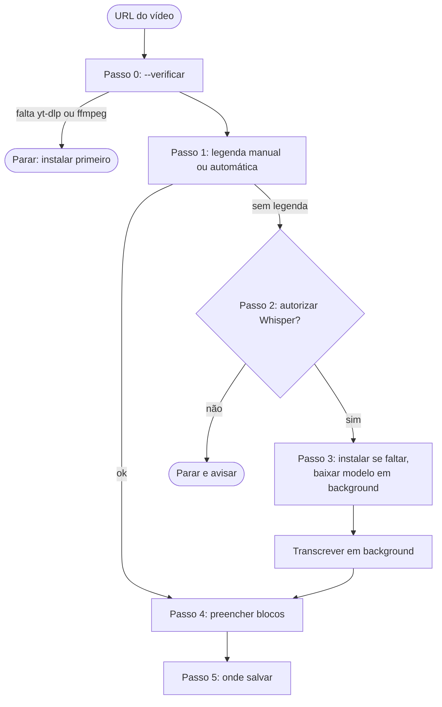

# Transcriptor YouTube → nota em markdown

A transcrição não é traduzida: sai no idioma falado no vídeo. O script faz o
trabalho mecânico e escreve a nota com o esqueleto pronto. O agente preenche
os blocos marcados como pendentes.



## Passo 0: verificar o ambiente

Antes de qualquer coisa:

```bash
python3 <skill>/scripts/transcribe_video.py --verificar
```

A saída é JSON. `yt-dlp` e `ffmpeg` são obrigatórios para qualquer vídeo. Se um
dos dois faltar, pare e diga ao usuário como instalar (o `install.py` mostra as
dicas por sistema). Não siga em frente sem eles.

O Whisper não é obrigatório. Ele só entra no passo 2, quando a legenda não existe.

## Passo 1: obter a legenda

```bash
python3 <skill>/scripts/transcribe_video.py "<url>" --out-dir <dir-temporario>
```

Sem `--out-dir`, o script usa um diretório temporário novo. Não crie pastas no
projeto do usuário nesta etapa. A língua falada vem de `language` nos metadados;
não passe `--primary` a menos que o script peça.

Ordem fixa: **legenda manual, depois automática**. Se o script sair com código
**3** e a mensagem `PRECISA_WHISPER`, não há legenda na língua falada. Só então
vá para o passo 2. Não use `--fonte whisper` sem passar pelo passo 2.

Se o script sair com código 2 (outro erro), pare e reporte o trecho do erro. Não
tente flags alternativas nem repetições em loop.

## Passo 2: pedir autorização para o Whisper

Quando o script disser `PRECISA_WHISPER`, avise o usuário antes de qualquer
download. Se já houver um Whisper instalado (`--verificar` mostra `true`):

> Esse vídeo não tem legenda manual nem automática em `<idioma>`. Posso
> transcrever o áudio localmente com `<ferramenta instalada>`. Isso é mais lento e
> baixa um modelo de cerca de 1,6 GB na primeira vez. Quer seguir?

Só siga com "sim". Se o usuário disser não, encerre e explique que a nota não foi
gerada. Se nenhum Whisper estiver instalado, use a pergunta do próximo trecho.

Se o `--verificar` mostrar que nenhum Whisper está instalado, faça **uma única
pergunta** que cubra tudo, sem instalar nada antes da resposta:

> Esse vídeo não tem legenda. Para transcrever, preciso de um Whisper, que ainda
> não está instalado. Posso instalar e usar um dos dois:
>
> - **mlx_whisper** (recomendado neste Mac): `pip install mlx-whisper`. Usa a GPU
>   do Apple Silicon e é mais rápido.
> - **openai-whisper**: `pip install openai-whisper`. Puxa o PyTorch, que é grande
>   (vários GB), e a transcrição tende a ser mais lenta.
>
> Qual você quer? Também vou baixar o modelo (cerca de 1,6 GB). Autoriza?

Recomende a ferramenta do sistema: `mlx_whisper` no Mac com Apple Silicon,
`openai-whisper` nos demais. Se o `--verificar` mostrar que a ferramenta
escolhida já está instalada, não é preciso instalar de novo. Se o usuário
recusar, pare e explique que a nota não foi gerada.

Só depois do "sim" e da escolha você instala o pacote escolhido com o comando
exato da pergunta, e então segue para a fase A ou B abaixo.

## Passo 3: preparar o modelo e transcrever, em background

Com o Whisper autorizado, rode as duas fases em **background** (`background:
true`), **sem `&` nem `nohup`**. Assim o aviso de conclusão chega quando o
processo de fato termina.

**Fase A, só com `mlx_whisper`: baixar e verificar o modelo**

```bash
python3 <skill>/scripts/transcribe_video.py --preparar --out-dir <dir-de-trabalho>
```

- Ao começar, diga ao usuário: "Baixando o modelo (cerca de 1,6 GB). Acompanho
  em `<dir>/progresso.txt`."
- Quando o shell avisar que terminou com a mensagem `modelo pronto e verificado`,
  diga: "Download concluído e verificado. Iniciando a transcrição."
- Se a saída trouxer erro de hash, pare e avise. Não use o arquivo.

Com `openai-whisper`, não há fase A: o pacote baixa o modelo na própria
transcrição. Avise o usuário que a primeira execução vai demorar por causa do
download.

**Fase B: transcrever**

```bash
python3 <skill>/scripts/transcribe_video.py "<url>" --fonte whisper --out-dir <dir-de-trabalho>
```

Ao iniciar, diga "Transcrição começando". O progresso vai para
`<dir>/progresso.txt`, em marcos de 5%, e o log completo para `whisper.log`.

Quando o shell avisar que terminou, leia a saída. Ela traz o caminho da nota. Se
o código de saída não for 0, reporte o erro e pare.

**Acompanhar sem ficar consultando.** O aviso de conclusão do shell basta. Leia
`progresso.txt` só se o usuário pedir. Não fique repetindo a leitura em loop.

## Passo 4: preencher os blocos pendentes

Leia a transcrição inteira antes de escrever. Preencha só os blocos que têm o
marcador `<!-- PENDENTE: agente preenche -->`.

**Classificação.** Escolha um valor de propósito e um de formato, na lista que
aparece no bloco. Use os dois campos do frontmatter (`proposito` e `formato`)
com o mesmo valor, e troque o marcador pelo valor escolhido. Se o vídeo não se
encaixa bem em nenhum valor, escolha o mais próximo e diga em uma linha por quê.
Use as categorias do YouTube só como pista: o conteúdo manda.

**Resumo.** Um parágrafo ou no máximo cinco frases, dizendo o que o vídeo
apresenta, qual é a tese ou o objetivo do autor e como ele conclui. Baseie-se só
no que está na transcrição e na descrição. Não acrescente contexto de fora.

**Pontos importantes.** Lista de 3 a 8 itens com timestamp. Cada item é uma
afirmação, decisão, número ou passo que o autor destaca.

**Pontos de atenção.** Lista de 2 a 6 itens com timestamp, para o leitor
conferir ou ter cuidado, por exemplo:

- afirmações do autor com ressalva ("depende", "em teoria", "não testei");
- números, versões, preços e prazos que valem conferir em fonte primária;
- promessas fortes ou resultados sem contexto;
- trechos onde a transcrição pode ter erro (nomes próprios, termos técnicos,
  números ditos rápido). Liste o termo e o timestamp, sem chutar a correção.

Se a transcrição veio do Whisper, diga isso nos pontos de atenção: a fonte tem
erros típicos diferentes da legenda automática.

Não invente pontos. Se o vídeo não tem nada de atenção, escreva isso em uma
linha em vez de forçar itens.

Não traduza a transcrição, não crie glossário, diagrama ou seção de aplicação.
Esses blocos não fazem parte desta skill.

## Passo 5: onde salvar

Use a primeira regra que se aplicar:

1. **Instruções do projeto.** Procure `AGENTS.md` ou `CLAUDE.md` no diretório
   de trabalho e nos pais. Se houver regra de destino para transcrições ou
   notas, siga-a. Se a regra não cobrir este caso, pergunte.
2. **Instruções existem, mas não falam de destino.** Salve em
   `transcriptions/transcription-<slug>.md`, relativo ao diretório de trabalho.
   Crie a pasta se não existir.
3. **Não existe nenhum `AGENTS.md` nem `CLAUDE.md`.** A nota fica no diretório
   temporário e você pergunta ao usuário onde salvar. Não escolha um destino
   sozinho.

O `<slug>` é kebab-case, sem acento, derivado do título do vídeo. Se o arquivo
já existir, pergunte antes de sobrescrever.

Regras que valem sempre:

- Markdown puro. Não gere HTML.
- Não invente fonte. A nota já traz a URL e a data de geração.
- Não faça commit, push nem qualquer outra ação de git sem pedido explícito. Se
  o usuário pedir, siga as convenções do projeto e confirme os arquivos antes.

## Armadilhas conhecidas

| Armadilha | O que fazer |
|---|---|
| `has no subtitles` no `--list-subs` | Enganoso. Só quer dizer que não há legenda **manual** no idioma pedido. Veja o bloco `automatic captions` |
| Texto com cada frase repetida | Janela deslizante. O dedup já roda no script; confira os resíduos |
| Capítulos por pausa em vídeo rápido | Não funciona: a distribuição é contínua. O script só usa capítulos oficiais ou blocos de tempo |
| Faixas `-orig` de muitos idiomas | Dublagens. O script usa a da língua falada |
| Whisper tem menos texto que a legenda automática | Comum com modelos menores. Confira trechos antes de dar a nota como completa |
| `yt-dlp` falhando | Pare e reporte (passo 1). Não tente flags em loop |

## Scripts

- `scripts/transcribe_video.py`: pipeline completo. Modos: `--verificar` (sem
  download), `--preparar` (baixa e verifica o modelo do mlx_whisper) e
  transcrição. Opções principais: `--fonte` (`auto`, `manual`, `whisper`),
  `--ferramenta` (`mlx` ou `openai`), `--whisper-model` (padrão
  `large-v3-turbo`), `--out-dir`, `--primary` e `--check`, `--bloco` (padrão 120 s)
  e `--limit` (janela do dedup, padrão 4,5 s).
- `scripts/srt_dedup.py`: dedup de SRT. `parse_srt`, `dedup` e `gaps`. Usável
  sozinho quando você já tem um SRT.
- `install.py`: instala a skill na pasta de skills do agente.

## Requisitos

- Python 3.9 ou mais novo
- `yt-dlp` e `ffmpeg` no PATH (sempre)
- Para o Whisper, só quando a legenda não existir: `mlx-whisper` no Mac com Apple
  Silicon, ou `openai-whisper` nos demais sistemas
